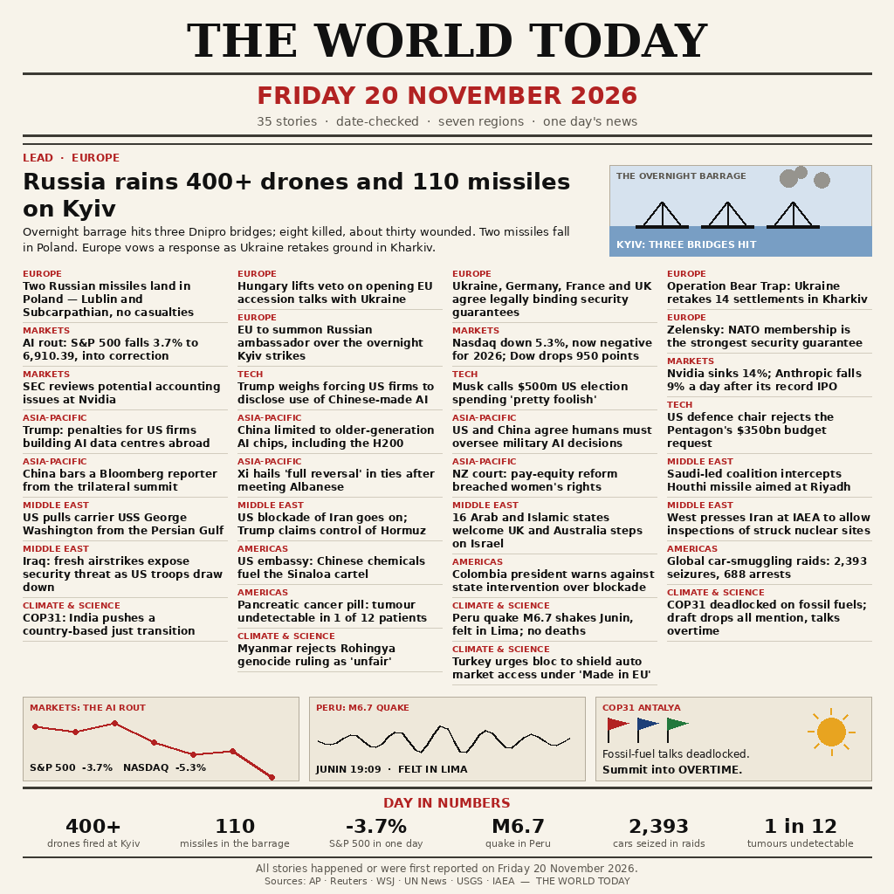

# The World Today — Friday 20 November 2026

[](https://make.fun/c/news-image-20261120)
[](https://make.fun/c/news-image-20261120)
[](https://make.fun/c/news-image-20261120)

One image that sums up the world's news of **Friday 20 November 2026**: a dense
newspaper front page — 35 short, date-checked stories across seven regions, a lead
story on Russia's overnight barrage of Kyiv (400+ drones, 110 missiles, three
Dnipro bridges hit), drawn illustrations (Kyiv bridges, the AI market rout,
Peru's M6.7 quake, COP31 Antalya), and a Day in Numbers strip.

[See the bounty](https://make.fun/bounty/news-image-20261120) · [make.fun](https://make.fun)

## The day in brief

- **Europe** — Russia's largest overnight strike on Kyiv; two missiles land in
  Poland; Hungary lifts its veto on Ukraine's EU accession talks; Ukraine retakes
  14 settlements in Kharkiv.
- **Markets** — AI rout: S&P 500 falls 3.7% into correction, Nasdaq down 5.3%,
  Nvidia sinks 14% a day after Anthropic's record IPO.
- **Asia-Pacific** — Trump sets AI data-centre and chip curbs after the Shenzhen
  trilateral; US and China agree humans must oversee military AI.
- **Middle East** — Saudi-led coalition intercepts a Houthi missile aimed at
  Riyadh; the US pulls a carrier from the Gulf; the Iran blockade goes on.
- **Climate & Science** — COP31 deadlocks on fossil fuels and goes into overtime;
  a M6.7 quake shakes Peru; Myanmar rejects the ICJ's Rohingya ruling.

Every story happened or was first reported on Friday 20 November 2026.

## Run

```sh
python3 main.py
```

Writes `entry.png` (1024×1024, ≤1 MiB) to `$MAKEFUN_OUTPUT_DIR` (default `/output`).
Python 3.13, standard library + Pillow only, no network. Fully deterministic:
two runs produce byte-identical output.


